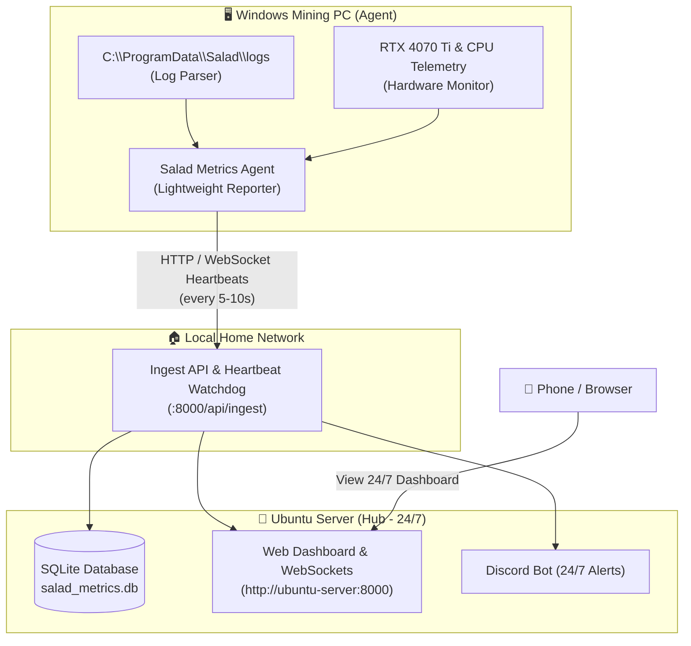

# 🥗 Salad Metrics | Ubuntu Server (Hub & Agent) Setup Guide

This guide explains how to host the **Salad Metrics Web Dashboard & Database** on a local 24/7 **Ubuntu Server (The Hub)** on your home network, while keeping the **Windows Mining PC (The Agent)** reporting to it.

---

## 🎯 Motivation & Benefits

When running all-in-one on the Windows PC:
- If Windows experiences a **BSOD**, crash, or reboot, the web server dies with it. Visiting the dashboard yields a browser error (*"Site cannot be reached"*).
- Discord alerts also stop working because the bot dies with the machine.

By separating the system into a **Hub & Agent** architecture:
1. **Crash & Offline Detection**: The website remains online 24/7. When the Windows mining rig stops sending telemetry, the dashboard immediately displays:
   > **`🔴 Status: OFFLINE / CRASHED`** *(Last seen 2 minutes ago)*
2. **Discord Bot Stays Online**: The Discord bot runs on Ubuntu 24/7. If the Windows rig stops reporting, the bot can alert you in Discord:
   > 🚨 **Alert: `Beast` has stopped reporting! Possible BSOD or crash detected.**
3. **Data Integrity**: SQLite data, charts, and wallet logs remain safe on the Ubuntu server across Windows reboots, driver updates, and crashes.

---

## 🏛️ Architecture Overview



---

## 🐳 Deployment Method 1: Docker Compose (Recommended)

Docker Compose is the fastest and cleanest way to run the Hub on your Ubuntu server. It requires zero compilation on Windows, handles persistent storage in `./data/`, starts automatically on boot, and keeps the environment isolated.

### 1. Copy Project Files to Ubuntu Server
From your Windows PowerShell:
```powershell
# Create folder on Ubuntu server (replace 192.168.1.100 with your Ubuntu server IP)
ssh user@192.168.1.100 "mkdir -p ~/salad-metrics"

# Copy project files needed for Docker
scp -r Dockerfile docker-compose.yml .dockerignore go.mod go.sum main.go internal templates static .env user@192.168.1.100:~/salad-metrics/
```

### 2. Start the Container on Ubuntu
SSH into your Ubuntu server:
```bash
ssh user@192.168.1.100
cd ~/salad-metrics

# Start the Hub in the background (builds the image automatically)
docker compose up -d --build
```

### 3. Check Logs & Status
```bash
# View live container logs
docker compose logs -f

# Check container status
docker compose ps
```

The dashboard is now live 24/7 at **`http://<ubuntu-server-ip>:8000`**!
The SQLite database will be saved persistently on Ubuntu in `~/salad-metrics/data/salad_metrics.db`.

---

## ⚙️ Deployment Method 2: Native Binary & Systemd (Alternative)

If you prefer running a direct native Linux binary without Docker:

### 1. Cross-Compile the Linux Binary (from Windows)
```cmd
cmd /c "set GOOS=linux&& set GOARCH=amd64&& go build -o salad-metrics-linux ."
```

### 2. Copy to Ubuntu
```bash
scp salad-metrics-linux user@192.168.1.100:~/salad-metrics/
scp -r static templates .env user@192.168.1.100:~/salad-metrics/
```

### 3. Configure Systemd Service
Create `/etc/systemd/system/salad-metrics.service`:
```ini
[Unit]
Description=Salad Metrics Dashboard Hub
After=network.target

[Service]
Type=simple
User=user
WorkingDirectory=/home/user/salad-metrics
ExecStart=/home/user/salad-metrics/salad-metrics-linux -port 8000 -mode=server
Restart=always
RestartSec=5
EnvironmentFile=/home/user/salad-metrics/.env

[Install]
WantedBy=multi-user.target
```

Enable and start:
```bash
sudo systemctl daemon-reload
sudo systemctl enable --now salad-metrics
```
```bash
sudo systemctl status salad-metrics
```

---

## 💻 Step 4: Configure the Windows Mining Agent

On your Windows mining PC (`Beast`), run `salad-metrics` in agent mode pointing to the Ubuntu server:

```bat
salad-metrics.exe -mode agent -server http://192.168.1.100:8000
```

The Windows agent will:
- Monitor local logs in `C:\ProgramData\Salad\logs`
- Sample RTX 4070 Ti and CPU telemetry
- Stream heartbeats and new events to `http://192.168.1.100:8000/api/ingest`
- Consume minimal RAM and CPU

---

## 🚨 Crash Watchdog Logic

When running in Server Mode on Ubuntu:
- Every report received from `Beast` updates a `last_seen_timestamp`.
- If `time.Since(last_seen_timestamp) > 60 seconds`:
  - Web UI status updates to **`🔴 Beast is OFFLINE (Crashed/Rebooting)`**.
  - Discord bot triggers an emergency ping:
    > ⚠️ **Alert:** `Beast` missed 6 consecutive heartbeats (possible BSOD or network drop).
- As soon as the Windows PC boots and resumes, status flips back to **`🟢 Running`** or **`🟡 Idle`** automatically.

---

## 📌 Implementation Status

- [x] Added `-mode=server` and `-mode=agent` flags in `internal/config/config.go`
- [x] Implemented `POST /api/ingest` endpoint on Hub server in `internal/api/routes.go`
- [x] Added agent streaming loop in `internal/agent/agent.go` with auto-reconnect & queue retention
- [x] Added heartbeat & crash watchdog in `internal/hub/hub.go`
- [x] Added automated Discord crash embed alerts in `internal/discord/bot.go`
- [x] Added `Offline / Crashed` red indicator and last seen timer in `static/js/app.js` and `static/css/style.css`
- [x] Created multi-stage `Dockerfile`, `docker-compose.yml`, and `.dockerignore` for 1-command Ubuntu deployment
